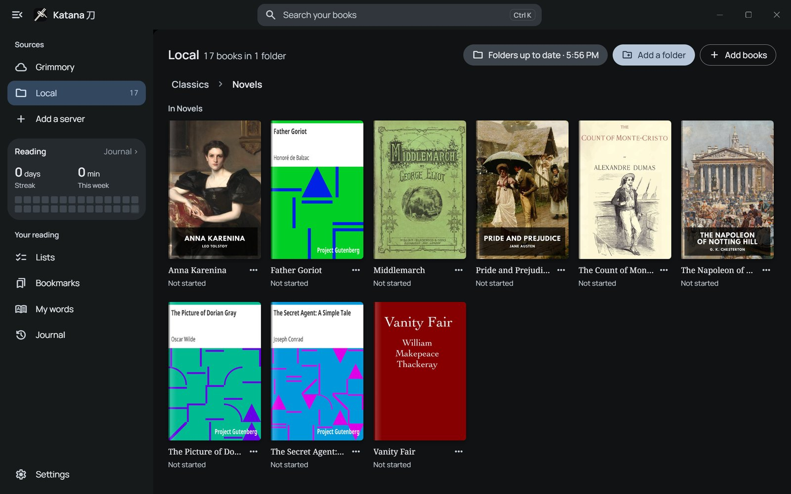
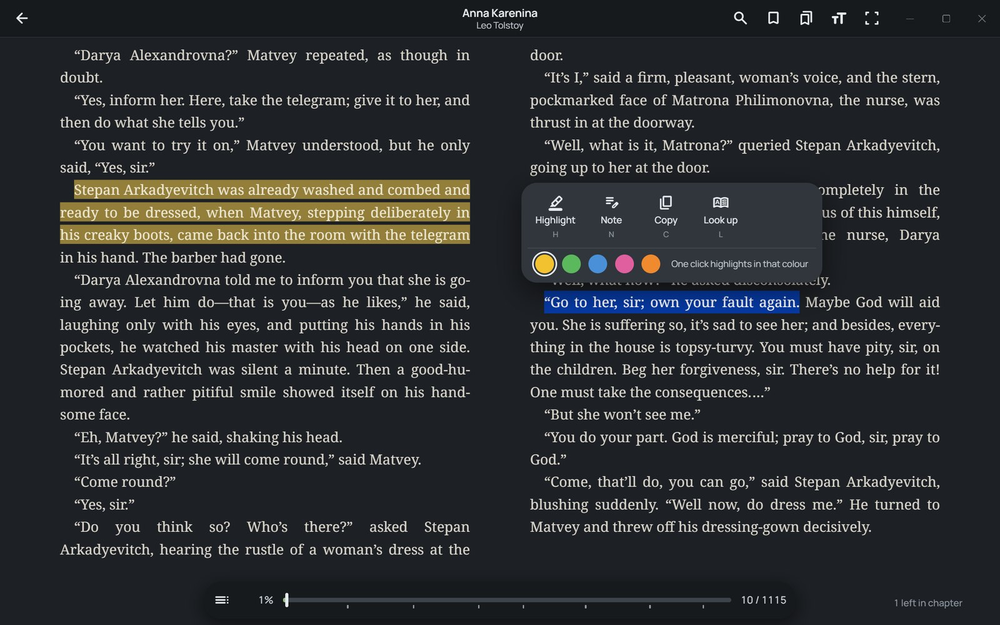
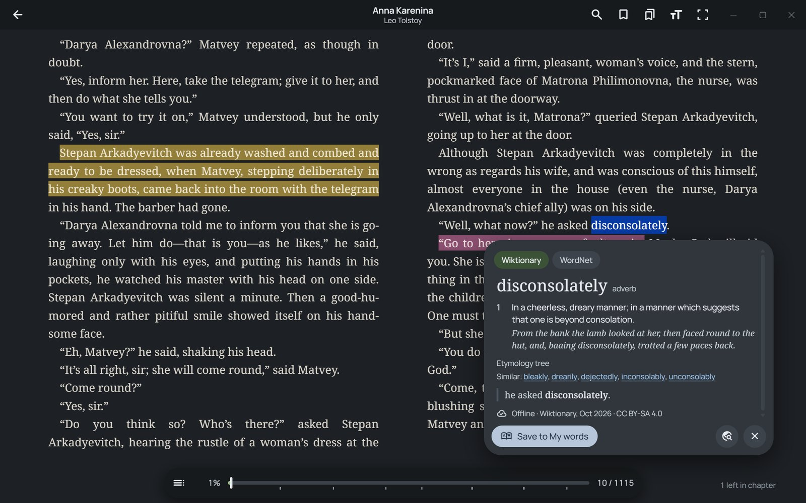
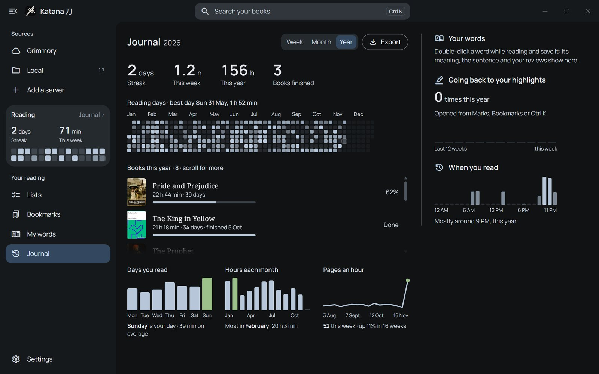
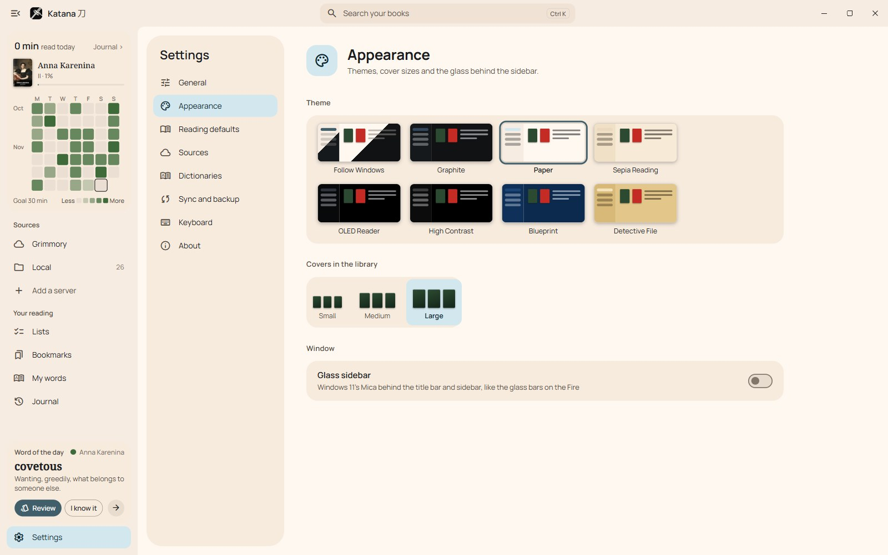
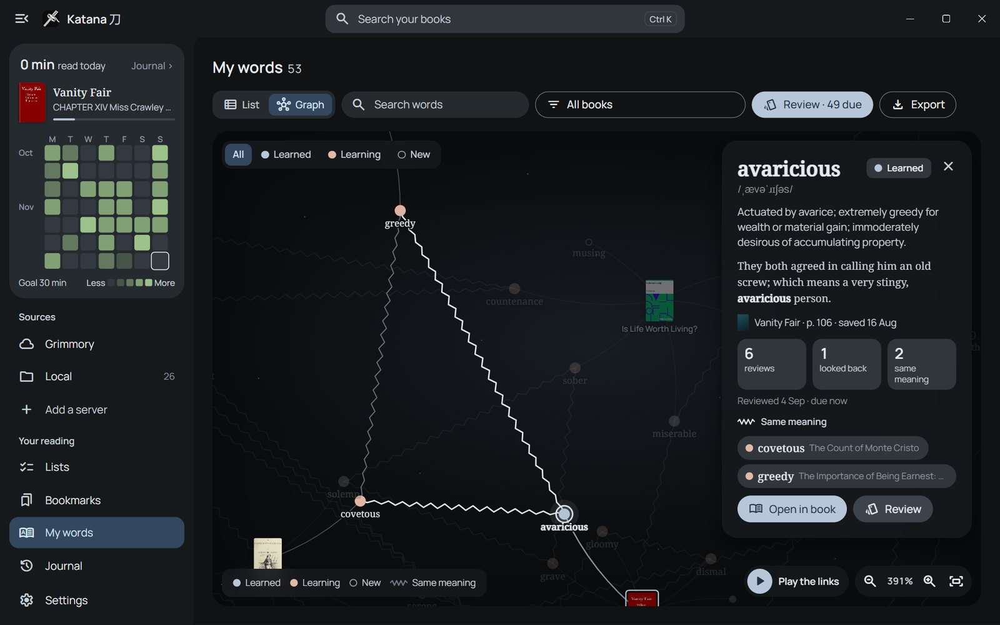
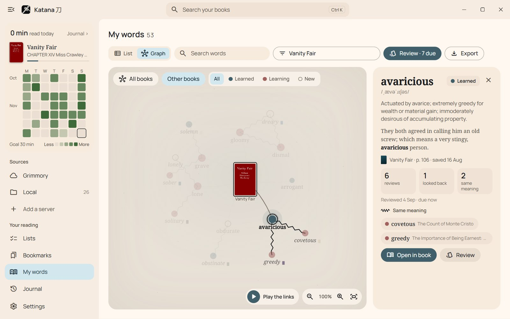

<p align="center"></p>

<h1 align="center">Katana Desk</h1>

<p align="center">A book reader for your computer that keeps up with your <a href="https://github.com/grimmory-tools/grimmory">Grimmory</a> server.<br>The desktop version of <a href="https://github.com/Dawit-Sh/Katana">Katana</a> (刀). Windows and Linux.</p>

<p align="center"></p>

## What it does

- **Reads pretty much everything:** EPUB, MOBI, AZW3, FB2, PDF, DjVu and comics (CBZ and CBR).
- **Syncs with Grimmory.** Your whole library shows up, books download for offline reading (and pick up where they stopped if the connection drops), and your reading place, highlights and bookmarks go both ways. Read on the PC, then carry on in Katana on your phone, Grimmory's web reader or KOReader.
- **Local folders too.** Point it at the folders where your books already live. It reads them in place, keeps the folder structure, and notices new books by itself.
- **Highlights and notes** in five colours and four styles (highlight, underline, strike, squiggle), in books and PDFs alike, with a marks panel and Markdown export.
- **Offline dictionaries built in.** Double-click any word for its meaning from English Wiktionary and WordNet, save it to My words, and go over your words later as flashcards. Your own StarDict dictionaries work too.
- **Your words as a graph.** My words shows every book with the words you saved from it around it, and words that mean the same joined across books. Zoom from covers to the whole map, hover a word to light up its synonyms, and play back how your words met, in the order you saved them.
- **A reading view that gets out of the way.** Bars fade while you read, panels float or pin to the side, one or two pages or scroll, and a full text panel (fonts, size, spacing, margins, page colours).
- **A Journal** of your reading: a year of reading days, streaks, books finished, when you read, and how your words are coming along.
- **Ctrl K finds anything:** books, authors, highlights, notes, bookmarks and words, across all your books.
- Eight themes, your own covers for any book, reading lists, a second window for a second book, and a keyboard map on `?`.

<table>
  <tr>
    <td></td>
    <td></td>
  </tr>
  <tr>
    <td></td>
    <td></td>
  </tr>
  <tr>
    <td></td>
    <td></td>
  </tr>
</table>

The books in the screenshots are public domain, from [Standard Ebooks](https://standardebooks.org) and [Project Gutenberg](https://www.gutenberg.org).

## Install

Grab the newest version from the [releases page](https://github.com/Dawit-Sh/katana-desk/releases/latest).

**Windows 10 or 11:** download `Katana.Desk_<version>_x64-setup.exe` and run it. It installs just for you, no admin needed. Windows may warn you that the app isn't common yet: click More info, then Run anyway.

**Linux:**

- **Any distro:** the `.AppImage`. Make it runnable and open it:
  ```
  chmod +x Katana.Desk_*_amd64.AppImage
  ./Katana.Desk_*_amd64.AppImage
  ```
- **Debian, Ubuntu, Mint and friends:** `sudo apt install ./Katana.Desk_<version>_amd64.deb`
- **Fedora, openSUSE and friends:** `sudo dnf install ./Katana.Desk-<version>-1.x86_64.rpm`

RAR comics (`.cbr`) need `bsdtar` (the `libarchive-tools` package), `unrar`, `7z` or `unar` on Linux. Everything else works out of the box.

**Updates:** the Windows app and the AppImage look for a new version once a day and ask before installing it (Settings › About). With the .deb or .rpm, grab the new package from the releases page.

**Dictionaries:** they download the first time you look a word up (about 160 MB for both), then work offline.

## Getting started

1. **Local:** click Add a folder and pick where your books are.
2. **Grimmory:** click Add a server, type your server's address and sign in. Your password goes to Grimmory once and isn't kept.
3. Click a book to see its page, double-click (or press Enter) to read. Press `?` anytime to see every key.

## Build it yourself

You need [Rust](https://rustup.rs), [Node.js](https://nodejs.org) LTS, and on Windows the Visual Studio C++ Build Tools. On Linux, the [Tauri prerequisites](https://v2.tauri.app/start/prerequisites/#linux) (WebKitGTK 4.1 and friends) and a C++ compiler for DjVuLibre.

```
npm install
npm run tauri dev      # run it while you work on it
npm run tauri build    # an installer in src-tauri/target/release/bundle
```

GitHub Actions builds and tests every push on Windows and Linux (`.github/workflows/ci.yml`), and `release.yml` makes the installers for a release. How every part works is in [docs/features.md](docs/features.md).

## Credits

Katana Desk stands on a lot of good work:

- [Tauri](https://github.com/tauri-apps/tauri) for the window, files and network (MIT or Apache-2.0)
- [foliate-js](https://github.com/johnfactotum/foliate-js) for EPUB, MOBI, AZW3 and FB2 (MIT)
- [PDF.js](https://github.com/mozilla/pdf.js) for PDF (Apache-2.0)
- [DjVuLibre](https://djvu.sourceforge.net/) for DjVu, built in from source (GPL-2.0-or-later)
- English [Wiktionary](https://en.wiktionary.org) through [wiktextract](https://github.com/tatuylonen/wiktextract) and [kaikki.org](https://kaikki.org) (CC BY-SA 4.0)
- [Open English WordNet](https://github.com/globalwordnet/english-wordnet) (CC BY 4.0), also inside the app as the words graph's synonym index
- [Open Library](https://openlibrary.org) for finding covers online
- Fonts: Literata, Source Serif, Noto Serif, Manrope and Atkinson Hyperlegible (all SIL Open Font License), and Material Symbols (Apache-2.0)
- [Readest](https://github.com/readest/readest) for ideas on how a Tauri reader can feel (no code taken)

## Licence

GPL-3.0-or-later, like Katana. See [LICENSE](LICENSE).
